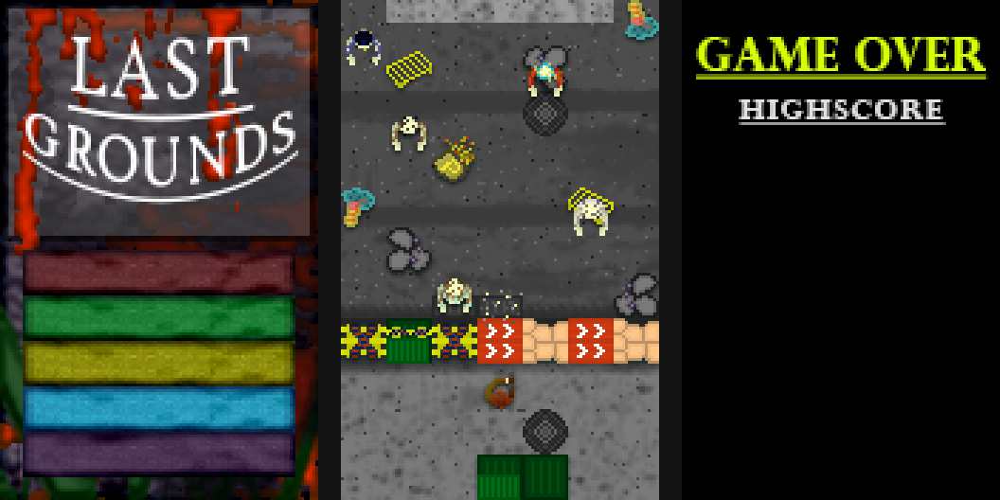

# Last Grounds

[](https://github.com/miguelrg14/Last-Grounds/actions/workflows/build.yml)
[](https://github.com/miguelrg14/Last-Grounds/releases/latest)
[](https://miguelrg14.github.io/Last-Grounds/)


A top-down pixel-art zombie horde shooter. Hold the last barricade, switch between three
weapons and survive as long as you can — or survive five days until rescue arrives.

Originally my **first game, made in GameMaker Studio 2**. This repository is a **port to
Unity 6 (C#)** that keeps the original art, sounds and game feel, and restructures the code
the way I would build it today.



*Composition of the original sprites (title, play field, game over).*

## Play

- **In the browser**: https://miguelrg14.github.io/Last-Grounds/
- **Windows / Linux**: download the zip from the [latest release](https://github.com/miguelrg14/Last-Grounds/releases/latest)
- **Android**: install the APK from the latest release, or play the browser version on your phone

## Features

- **Six modes**: Story (survive 5 days), Ascent (8 escalating waves), Easy, Normal, Hard and Hardcore.
- **Five zombie types**: normal, fast, fat (tanky), scientist (regenerates and teleports
  between lanes) and police (shoots at the barricade).
- **Three weapons**: pistol, shotgun (wide blast) and an automatic MP7.
- **Per-mode top-10 leaderboard** with name entry, saved locally.
- **Options**: music and SFX volume, fullscreen.
- Keyboard, mouse, **gamepad** and **touch** support; every menu can be driven without a mouse.
- **Plays on phones**: on-screen controls appear automatically on touch screens, in the
  Android app and in mobile browsers alike (same project, same web build).
- Pixel-perfect letterboxed rendering at the original 112×176 resolution.

## Controls

| Action | Keyboard | Gamepad | Touch |
| --- | --- | --- | --- |
| Move | ← → / A D | Left stick / D-pad | Hold the < > buttons (left) |
| Shoot | Space | A / Right trigger | Hold FIRE (right) |
| Switch weapon | 1 2 3, Q / E, Ctrl | LB / RB | Weapon buttons |
| Pause | Esc / P | Start | II button / Android back |
| Fullscreen (browser) | Button under the game | — | — |
| Clear leaderboard (game over screen) | C | — | CLEAR LIST button |

## Opening the project

1. Open the folder with **Unity 6** (6000.0 LTS or newer) from Unity Hub.
   If your exact version differs, Hub lets you pick an installed Unity 6 version.
2. If Unity asks to enable the new Input System backends, accept. (The code also works
   with the legacy Input Manager.)
3. On the first open, an editor script **builds the game automatically**: import
   settings, data assets, prefabs, the three scenes and the build settings.
   It finishes by opening `Assets/LastGrounds/Scenes/Menu.unity`.
4. Press **Play**. For the original window shape, set the Game view to 672×1056.

You can regenerate everything at any time from **Last Grounds → Rebuild Project**.

### Capture tools (editor and development builds only)

| Key | Action |
| --- | --- |
| F12 | Save a screenshot to `Screenshots/` (project root) |
| F10 | Hide / show the UI for clean shots |
| F9 | Invincible barricade, to record long gameplay takes |

## Building

Builds are made by GitHub Actions with [GameCI](https://game.ci)
([`.github/workflows/build.yml`](.github/workflows/build.yml)):

| Trigger | Result |
| --- | --- |
| Actions → *Build & Release* → **Run workflow** | WebGL, Windows, Linux and Android (APK) builds as artifacts; web version deployed to GitHub Pages |
| Push a tag `v*` (e.g. `git tag v1.0.0 && git push origin v1.0.0`) | The above, plus a GitHub Release with the zips and the APK, and an upload to itch.io |

CI calls `LastGrounds.EditorTools.CIBuild.Build`, which generates the project and builds
the player, so the generated folders do not need to be committed.

**One-time setup**

1. **Unity license**: activate Unity Personal in Unity Hub on your machine, then copy the
   contents of the license file into a repository secret named `UNITY_LICENSE`
   (Windows: `C:\ProgramData\Unity\Unity_lic.ulf`, macOS: `/Library/Application Support/Unity/Unity_lic.ulf`,
   Linux: `~/.local/share/unity3d/Unity/Unity_lic.ulf`). Add `UNITY_EMAIL` and `UNITY_PASSWORD` too.
2. **GitHub Pages**: Settings → Pages → Source: **GitHub Actions**.
3. **itch.io (optional)**: create the game page, add the secret `BUTLER_API_KEY`
   (from https://itch.io/user/settings/api-keys) and the variable `ITCH_GAME`
   (e.g. `miguelrg14/last-grounds`). Channels: `html5`, `windows`, `linux`, `android`.
   For the web version tick **Mobile friendly** (orientation: portrait) so it is offered on phones.
4. **Android signing (optional)**: without a keystore the APK is signed with Unity's debug key,
   which is fine for itch.io and installing by hand. For Google Play, create a keystore
   (Unity: Project Settings → Player → Android → Publishing Settings → Keystore Manager) and add
   `ANDROID_KEYSTORE_BASE64` (`base64 -w0 your.keystore`), `ANDROID_KEYSTORE_PASS`,
   `ANDROID_KEYALIAS_NAME` and `ANDROID_KEYALIAS_PASS`. Keep the keystore safe: every update
   must be signed with the same one.

**Building Android locally**: install *Android Build Support* (with OpenJDK and SDK & NDK)
for your Unity version in Unity Hub, switch to Android in Build Profiles and build.
Settings (portrait, `com.miguelrg14.lastgrounds`, IL2CPP, ARM64) are applied by the builder.

## How the port is structured

```
Assets/LastGrounds/
├── Art/            Sprites, backgrounds, UI and the Silkscreen font
├── Audio/          Music and SFX from the original
├── Data/           ScriptableObjects: weapons, enemies, game modes   (generated)
├── Prefabs/        Zombies and projectiles                            (generated)
├── Scenes/         Menu, Game, GameOver                               (generated)
└── Scripts/
    ├── Runtime/
    │   ├── Core/       PlayField geometry, input layer, settings, pooling, viewport
    │   ├── Data/       WeaponData, EnemyData, GameModeData (+ spawn phases)
    │   ├── Gameplay/   GameManager, PlayerController, Enemy, Barricade, spawner…
    │   ├── Audio/      Persistent AudioManager
    │   └── UI/         Menus, HUD, options, game over + leaderboard
    └── Editor/         Import rules and the project builder
```

### From GameMaker to Unity

The GameMaker version solved every variation by duplicating objects and rooms.
The port turns those duplicates into data:

| GameMaker (original) | Unity (port) |
| --- | --- |
| 5 generators, 5 barriers, 5 highscore objects, 5 game-over rooms (one per difficulty) | 1 `EnemySpawner`, 1 `Barricade`, 1 `GameOverController` + one `GameModeData` asset per mode |
| `oGeneradorEscalada` with 8 hand-written alarms | 8 `SpawnPhase` entries (start time, interval, enemy weights) |
| `PersonajePistolaObj` / `EscopetaObj` / `MP7Obj` with copied code | 1 `PlayerController` + 3 `WeaponData` assets |
| Damage code repeated in every zombie × bullet collision event | `Enemy.TakeDamage`, with damage taken from the weapon |
| 12 menu rooms | Panels in one Menu scene driven by `MenuController` |
| `alarm[n]` | Coroutines and timers |
| `place_meeting` collisions | Swept `Physics2D.BoxCastAll`, so fast bullets never tunnel |
| `instance_create` / `instance_destroy` for bullets | `PrefabPool` (the MP7 fires 30 bullets/s) |
| `highscore_add` (one global table) | Per-mode JSON leaderboard in `PlayerPrefs` |

Original values were converted exactly: speeds in px/frame at 60 fps become units per
second (16 px = 1 unit), and alarm frames become seconds.

### What changed besides the code

- **Finished features that were left half-done**: weapon switching (commented out),
  Story mode (unreachable from the menu, with no ending), the police zombie (shooting
  commented out, never spawned) and the scientist's teleport (its alarm was reset every
  step, so it never fired).
- **Fixed bugs**: the fast zombie ignored MP7 bullets and never gave points or played its death sound.
- **New**: pause menu, options screen (it was empty), wave/day banners, hit flashes,
  barricade damage tint, gamepad and full keyboard navigation in menus.

The original GameMaker project is kept in [`GameMaker-Original/`](GameMaker-Original)
for reference.

## Credits

- Design, programming and art: **Miguel Rodríguez Gallego**
- Sound effects: Mike Koenig, Dion Stapper
- Music: Patrick de Arteaga
- Font: [Silkscreen](https://fonts.google.com/specimen/Silkscreen) by Jason Kottke
  (SIL Open Font License, see `Assets/LastGrounds/Art/Fonts/Silkscreen-OFL.txt`)

## License

Code under the [MIT License](LICENSE). Third-party audio and font keep their own licenses.
